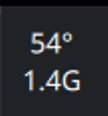
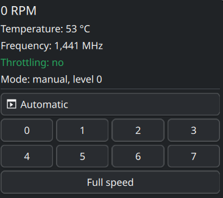

# ThinkPad Fan Control

A Plasma 6 panel widget for ThinkPad laptops: shows fan speed, temperature, CPU
frequency and thermal throttling — and lets you pin the fan to a fixed level
straight from the panel.

Plasma ships widgets that *display* sensors, but nothing that *controls* the fan.
This one does both.

<p align="center">
  
  &nbsp;&nbsp;&nbsp;
  
</p>

In the panel: temperature on top, CPU frequency below — the frequency turns red
when thermal throttle events occur between polls. The first poll establishes a
baseline, so the event count is unknown until the next poll. Click for readings
and fan levels.

## Features

- fan RPM, temperature, CPU frequency in the panel (second line is configurable)
- **throttling indicator** — the frequency turns red when thermal throttle
  events occur during the poll interval
- one-click fan levels: `automatic`, `0`–`7`, `full speed`
- mode reporting distinguishes automatic via thinkfan, automatic via firmware,
  a level held manually, a level without a running hold, and unknown state
- levels are *held*: the firmware and thinkfan both overwrite a manually set
  level within seconds, so a helper watches it and puts it back
- safety net: a pinned level is released if the CPU exceeds 90 °C

## Requirements

- Plasma 6
- a ThinkPad with the `thinkpad_acpi` module (`/proc/acpi/ibm/fan` must exist)
- fan control enabled in the module:

  ```sh
  echo 'options thinkpad_acpi fan_control=1' | sudo tee /etc/modprobe.d/thinkpad_acpi.conf
  sudo modprobe -r thinkpad_acpi && sudo modprobe thinkpad_acpi
  ```

## Install

```sh
git clone https://github.com/aiseeq/plasma-thinkpad-fan
cd plasma-thinkpad-fan
./install.sh
systemctl --user restart plasma-plasmashell
```

Then right-click the panel → *Add Widgets* → **ThinkPad Fan Control**.

Uninstall with `./install.sh --uninstall`. It stops the hold and restores
automatic fan control (starting thinkfan when installed) before removing the
widget and helpers. If restoration fails, it reports the error and leaves the
installed components in place.

## Configuration

If the fan reading stays at 0, the sensor id differs on your model. Open the
widget settings and pick the right one; list what is available with:

```sh
busctl --user call org.kde.ksystemstats1 /org/kde/ksystemstats1 \
       org.kde.ksystemstats1 allSensors | tr ' ' '\n' | grep -oE '"lmsensors/[^"]*"'
```

## How it works

| Component | Role |
| --- | --- |
| `thinkpad-fan-status` | unprivileged; reports level, thinkfan state, frequency, throttle counter, hold state |
| `thinkpad-fan-set` | privileged; validates the argument and switches mode |
| `thinkpad-fan-hold` | systemd unit; keeps the chosen level from being overwritten |

### Privileges

The widget calls `thinkpad-fan-set` through `pkexec`. The shipped polkit rule
allows the *locally logged-in* user to do this without a password — otherwise
every click would raise a prompt. The privilege is narrow: the helper accepts
nothing but `auto|0-7|full` and rejects everything else.

If you would rather be asked for a password, edit
`/usr/share/polkit-1/actions/com.github.aiseeq.thinkpadfan.policy` and change
`<allow_active>yes</allow_active>` to `auth_admin_keep`.

### Why levels have to be held

Writing a level once is not enough. `thinkfan`, if running, reapplies its own
curve within seconds; the embedded controller also revises the level on its own.
So `thinkpad-fan-hold` checks the level every second and writes it back if
something changed it — a foreign change survives at most one interval. It
deliberately does *not* rewrite blindly: on some coolers every write restarts
the EC's spin-up ramp, and a rewrite every 100 ms left the fan stuck at
~2000 RPM whatever level was requested.

Tune it with environment variables in the unit:
`THINKPAD_FAN_INTERVAL` (seconds, default `1`) and `THINKPAD_FAN_TCRIT`
(°C, default `90`; temperatures are compared in millidegrees and protection
triggers strictly above the threshold; `0` disables the safety net). If the
temperature sensor becomes unavailable, the hold reports an error and restores
automatic control.

The status helper prints five pipe-separated fields: fan level, thinkfan state,
average CPU frequency in MHz, thermal throttle event counter, and hold service
state (`active`, `inactive`, or `unknown`). Unavailable frequency or counter
readings are printed as `unavailable` rather than zero.

## Known limitations

- **The throttling indicator sees thermal throttle events only.** It reports
  growth in `package_throttle_count` between polls; the first poll is unknown.
  A power (RAPL/TDP) limit does not raise that counter even though it holds the
  frequency down.
- `package_throttle_total_time_ms` is always 0 on some Intel generations
  (confirmed on Meteor Lake / Core Ultra 155H), which is why the event counter is
  used instead.
- `full speed` (`disengaged`) behaves differently across models — on some it does
  not spin the fan up at all.
- Fan levels are a ThinkPad/`thinkpad_acpi` feature. On other laptops the widget
  will show sensors but the level buttons will not work.
- **A pinned level does not survive a reboot.** `thinkpad-fan-hold` is started as
  a transient systemd unit, so after a restart the fan is back under automatic
  control. To pin a level at boot, add a unit of your own:

  ```ini
  # /etc/systemd/system/thinkpad-fan-default.service
  [Unit]
  After=multi-user.target
  [Service]
  Type=oneshot
  RemainAfterExit=yes
  ExecStart=/usr/local/bin/thinkpad-fan-set 7
  [Install]
  WantedBy=multi-user.target
  ```
- The widget does not warn when `fan_control` is disabled in `thinkpad_acpi` —
  the level buttons simply do nothing. `install.sh` checks this at install time.

## Tested on

- ThinkPad E16 Gen 2 (21MA, Core Ultra 7 155H), Fedora 44, Plasma 6.7.3

Reports from other ThinkPads are welcome — especially whether `full speed`
behaves sanely and which sensor ids your model needs.

## Caution

Pinning `level 0` disables the fan entirely. The 90 °C safety net helps, but do
not leave a laptop pinned at a low level under sustained load.

## License

MIT — see [LICENSE](LICENSE).
